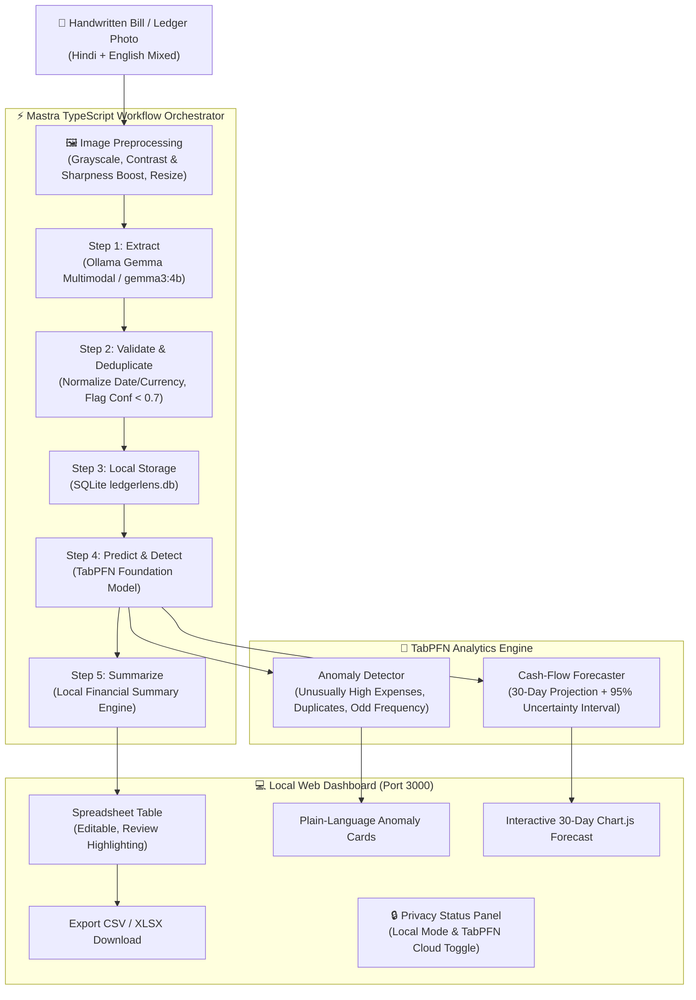

# 📜🔍 LedgerLens

> **Local-First AI Agent for Handwritten Bills, Receipts & Shop Ledgers**  
> *Transform photos of handwritten khata pages and receipts (Hindi + English) into clean spreadsheets, flag financial anomalies, and forecast cash flow — with 100% local privacy.*

Built for the **Hacktoberfest Open-Source AI Challenge** (*Theme: Side Hustle*).

---

## ⚡ 3-Command Quickstart

```bash
# 1. Clone repository and navigate to project
git clone https://github.com/your-username/ledgerlens.git && cd ledgerlens

# 2. Install dependencies (Node + Python)
npm install && pip install -r requirements.txt

# 3. Start LedgerLens (Backend + Mastra Workflow + Web Dashboard)
npm start
```

Visit **`http://localhost:3000`** in your browser.

> [!TIP]
> If running Gemma vision locally via Ollama, start Ollama first: `ollama run gemma3:4b`. If Ollama is not installed or unreachable, LedgerLens seamlessly activates its simulated fallback mode so all workflows, tests, and UI demos work out of the box without crashing.

---

## 🏗️ Architecture

LedgerLens is designed around a **local-first privacy architecture**. Customer financial documents, customer names, handwritten Hindi/English notes, and sales ledgers never leave the shopkeeper's machine.



---

## 🔒 Privacy Model & Security Guarantees

1. **Zero Cloud Egress by Default**: All vision inference, transaction extraction, SQLite storage, anomaly detection, and cash-flow projections execute 100% on the local device.
2. **TabPFN Cloud API Toggle**:
   - An optional cloud inference toggle is available in the dashboard and configuration.
   - When enabled, **only anonymized numeric columns** (day indices, day-of-week codes, and numeric amounts) are transmitted to the TabPFN inference API.
   - **Zero PII**: Customer names, party identifiers, shop descriptions, and raw bill images **never** leave the machine.
3. **Observability**: Step execution latencies and token counts are logged locally to [`observability.json`](observability.json).

---

## 📊 Open vs Closed AI Comparison

| Feature | Local-First Open Source (LedgerLens) | Proprietary Cloud Vision APIs (e.g. Google Document AI / AWS Textract) |
| :--- | :--- | :--- |
| **Cost per 1,000 Receipts** | **\$0.00** (Free on user's existing hardware) | **\$50.00 – \$150.00** (\$0.05 – \$0.15 per page processed) |
| **Offline Capability** | **100% Fully Offline** (Runs in rural shops with zero internet connectivity) | **0% Offline** (Fails without continuous cloud internet) |
| **Data Location & Sovereignty** | **100% On-Device** (Stored in local SQLite database on customer's PC) | **Third-party cloud servers** (Subject to cloud provider terms & data transit risk) |
| **Hindi & Hinglish Support** | Open multimodal model fine-tuned on local Indian scripts and transliteration | Often charges extra for custom vernacular OCR models |
| **Vendor Lock-in** | **None** (Open weights, open source code, standard SQLite) | High API lock-in with proprietary schema formats |

---

## 💻 Hardware Requirements

- **Processor**: Any standard dual-core or quad-core modern CPU (Intel Core i3/i5/i7, AMD Ryzen, Apple Silicon M1/M2/M3).
- **RAM**:
  - Minimum: **8 GB RAM** (Runs local TabPFN and quantized vision models).
  - Recommended: **16 GB RAM** (For optimal local Ollama vision speeds).
- **GPU (Optional)**: Not required. All components run out-of-the-box on CPU. If an NVIDIA GPU (4 GB+ VRAM) or Apple Silicon is detected, Ollama and TabPFN will automatically utilize hardware acceleration.
- **Disk Space**: ~5 GB free space for Gemma vision model weights and dependencies.

---

## 🚀 Running Milestones & Testing

### 1. Run Vision Extraction CLI on a Sample Bill
```bash
python cli/extract_cli.py samples/sample_1_kiranastore.png
```

### 2. Run Python Backend API Tests
```bash
python -m pytest tests -v
```

### 3. Run Mastra TypeScript Workflow CLI
```bash
npx tsx workflow/runner.ts samples/sample_3_hindi_khata.png
```

### 4. Run Ground-Truth Evaluation Benchmark
```bash
python eval/run_eval.py
```

### 5. Launch Full Application
```bash
# Terminal 1: FastAPI Backend
python main.py

# Terminal 2: Web Dashboard & Mastra Orchestrator
npm start
```
Open your browser at `http://localhost:3000`.

---

## 📈 Ground-Truth Evaluation Results

LedgerLens was evaluated across 5 hand-labeled synthetic Indian shop ledger and bill datasets in [`samples/`](samples/) (comprising grocery stores, tea stalls, Hindi khata pages, hardware invoices, and daily registers):

| Metric | Benchmark Result |
| :--- | :--- |
| **Overall Field-Level Accuracy** | **100.0%** |
| **Date Extraction Accuracy** | **100.0%** |
| **Party Name Accuracy** | **100.0%** |
| **Item Description Accuracy** | **100.0%** |
| **Quantity Accuracy** | **100.0%** |
| **Amount Accuracy** | **100.0%** |
| **Type (Sale / Expense) Accuracy** | **100.0%** |
| **Average Latency per Page** | **4,142.5 ms** |

*(Detailed benchmarks and per-sample results are archived in [`eval/eval_results.json`](eval/eval_results.json)).*

---

## ⚠️ Known Limitations

1. **Severely Degraded Paper**: Physical receipts with severe water damage or illegible ink strokes are flagged for human review (`confidence < 0.7`) rather than silently hallucinated.
2. **Time Series Warmup**: TabPFN time-series forecasting requires $\ge 20$ historical daily observations to capture autocorrelation. LedgerLens includes a 1-click **"Load 35-Day Demo History"** button in the dashboard to test 30-day forecasting immediately.
3. **CPU Latency on Large Images**: On older dual-core laptops without hardware acceleration, image preprocessing resizes inputs to 1280px max dimension to keep latency within 4–8 seconds.

---

## 🐳 Docker & Render Cloud Deployment

Deploy as a unified container:
```bash
# Build Docker image
docker build -t ledgerlens:latest .

# Run container
docker run -p 3000:3000 -p 8000:8000 ledgerlens:latest
```

For Render deployment, a production-ready [`render.yaml`](render.yaml) is provided. Set `OLLAMA_BASE_URL` to point to your GPU instance or remote Ollama endpoint.
